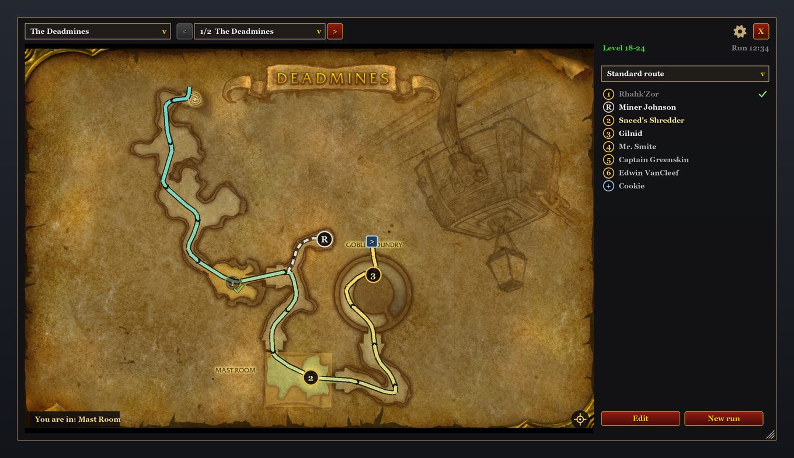
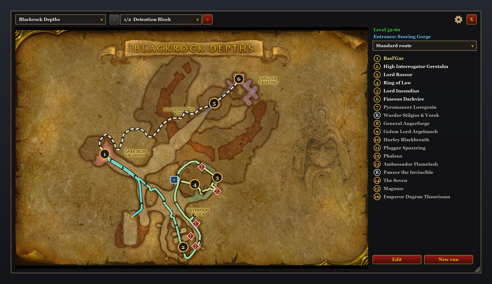
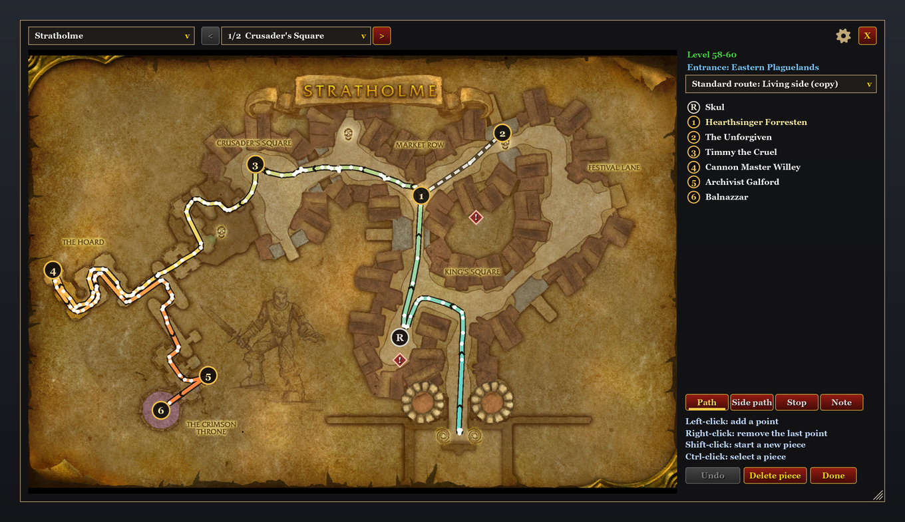
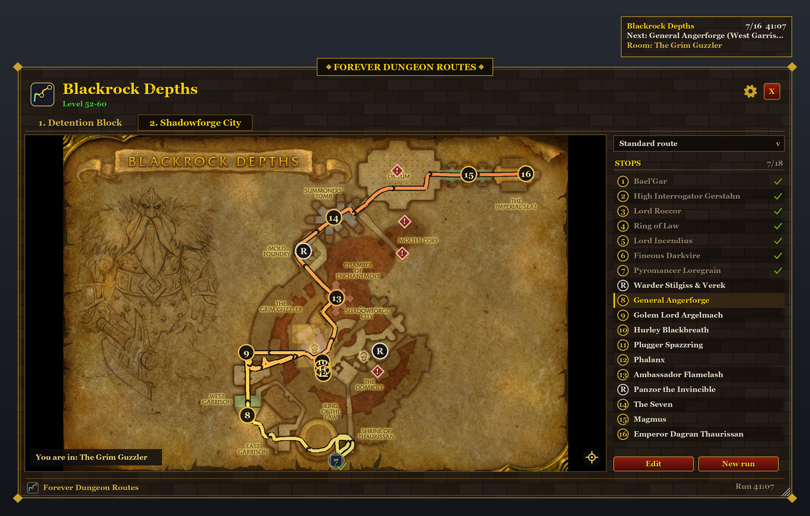
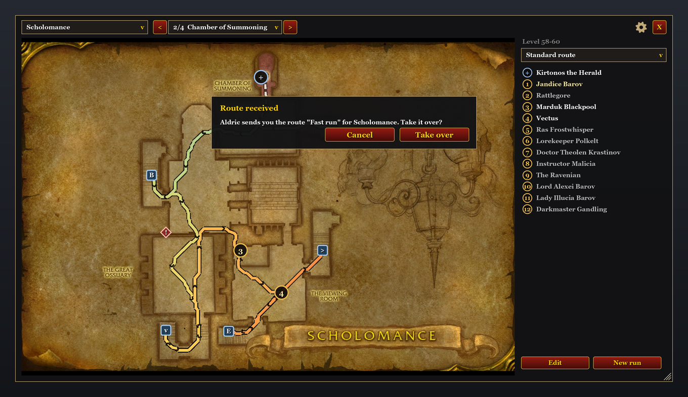
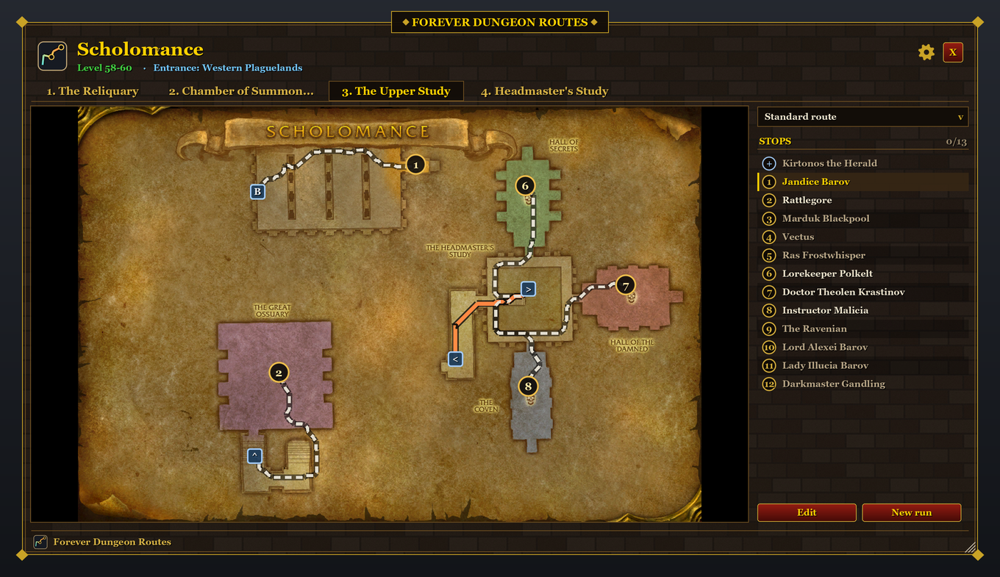
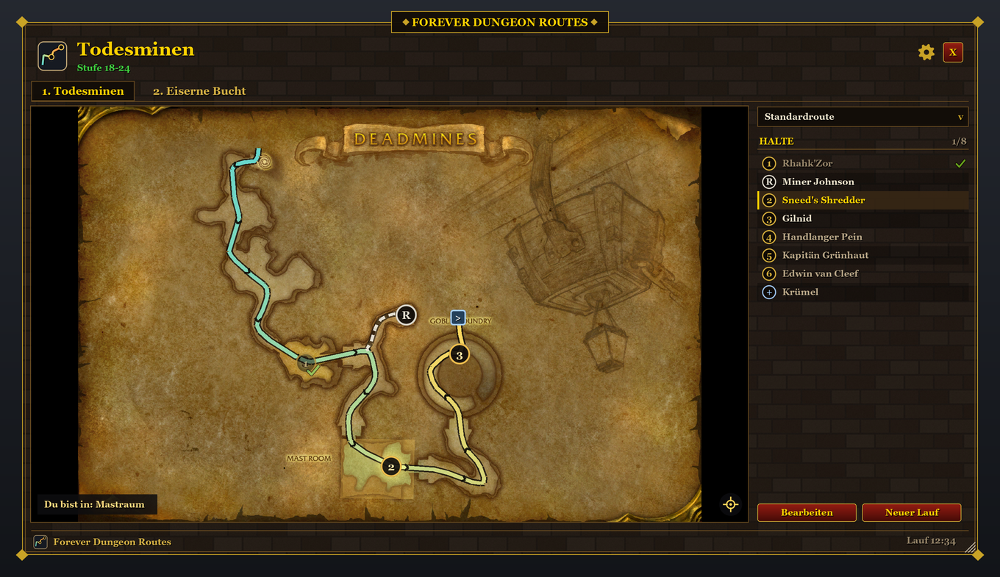
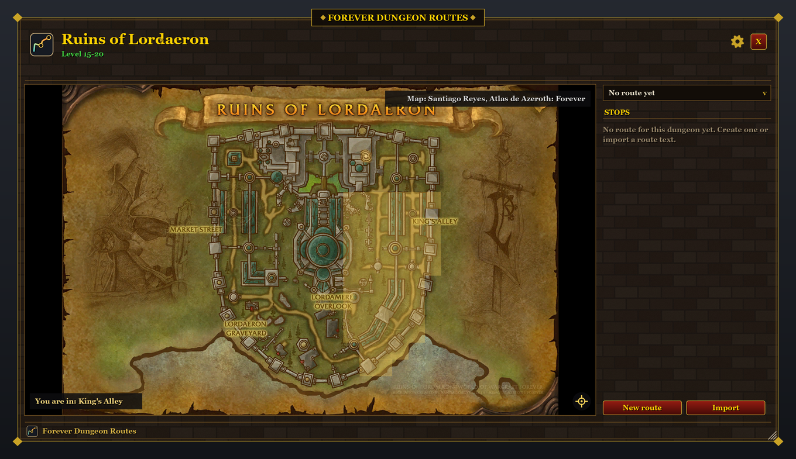
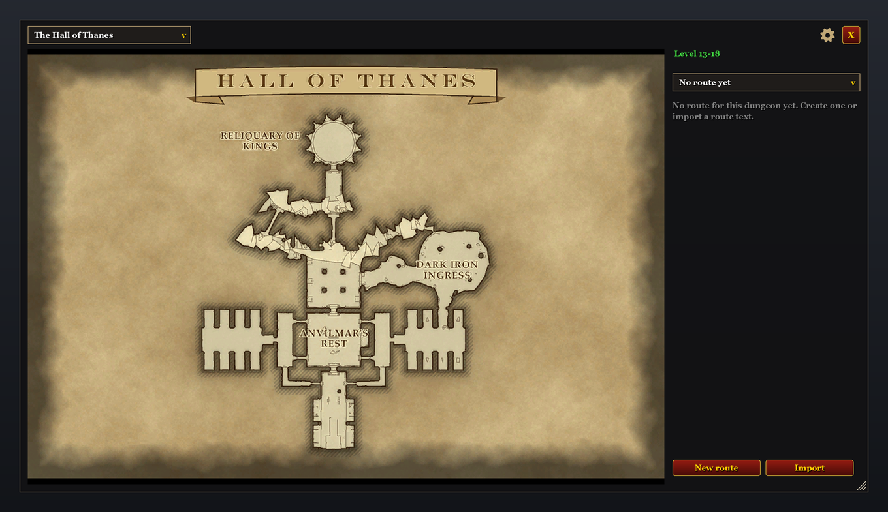

# Forever Dungeon Routes

A dungeon map with routes for **World of Warcraft: Forever**, for all 28 dungeons and the 7 raids:
ready routes for the 24 classic dungeons, own maps for the 4 new Forever dungeons, the bosses of the
raids, boss order and notes, bosses that tick themselves off, an editor for your own routes in the
spirit of Mythic Dungeon Tools, and a route list where players put up their routes for everyone.

| Browsing Blackrock Depths: level and entrance | Editing a copy of a standard route |
|---|---|
|  |  |
| **Inside Blackrock Depths: the room lights up, above the small display** | **A group member sends a route** |
|  |  |
| **Scholomance: blue squares lead to the other map levels** | **German game client** |
|  |  |
| **New in WoW: Forever: Ruins of Lordaeron, the map drawn from the game's floor plan** | **The Hall of Thanes** |
|  |  |

These are preview images, not in-game screenshots: the addon's own code runs against a replica of
the game's interface functions, and every frame, line and texture it creates is drawn with the map
art from the game client. Fonts and buttons are close approximations. In-game screenshots will
replace them.

## Features

- Own map window with the game's dungeon map art. WoW: Forever has no dungeon maps of its own, but
  the art files are still in the game client; the addon draws them itself. No other addon needed.
- Standard routes for all 24 classic dungeons. The line color runs from the entrance to the last
  boss, arrows show the walking direction, dashed lines mark side paths.
- The four new dungeons of WoW: Forever (The Hall of Thanes, Ruins of Lordaeron, Excavation Site:
  Wetlands, City of Dalaran): the game has no map art for them, so the addon brings maps drawn from
  the floor plans in the game's files. Their rooms light up and their bosses tick themselves off;
  standard routes for them follow, until then draw your own.
- All seven raids (Molten Core to Naxxramas): the game's map art, rooms and areas, bosses that tick
  themselves off, and a standard route "Bosses" with each boss where the game's dungeon journal has
  it (no paths yet). In the dungeon list they sit in the submenu "Raids".
- Numbered bosses in route order, rares (`R`), optional bosses (`+`) and notes (`!`) with keys,
  events and quest items. Blue squares switch to the next map level.
- Where you are, as well as the game allows: WoW gives addons no position inside dungeons (since
  patch 7.1), so there is no arrow for you or your group. But the game names the room you are in
  (the text above the minimap). The addon knows where these rooms lie: the room lights up on the
  map, its name stands below, and the map follows you to its level. Between named rooms the map
  follows your run: after a boss kill it shows the level of the next open boss.
- Your group on the map: the rooms of the others in your group light up blue with their names
  (players with the addon). Ticks by hand reach the whole group, and Alt-click shows a stop to all.
- Stop list with checkmarks per character. Bosses tick themselves off when the game reports the
  kill; rares without a boss fight are ticked by hand. "New run" clears the checkmarks, an old run
  is cleared after three hours.
- The way to the dungeon: outside, a click on "Entrance: <zone>" sets a map pin at the entrance that
  the game tracks, so the arrow on the screen leads there.
- Dungeons for your level: the dungeon list colours the names by your level, like quests.
- Run time from entering the dungeon to the last boss, your best time and your last runs per
  dungeon.
- Small display in dungeons (optional): dungeon, bosses down, run time, the next boss with its room
  and your room in a small box, for when the map stays closed.
- Route from the last run: the addon notes where the bosses fell; one click makes a route of it.
- Route editor: paths, side paths, stops and notes; drag to move, undo. Editing a standard route
  creates a copy.
- Share routes with your group or your guild in game: everyone with the addon gets the route
  offered and takes it over with one click. Post the boss order in the group chat for players
  without the addon, or share routes as text (export and import).
- Route list: players put their routes up for everyone, a click takes a route over, and good routes
  get recommended. The list comes from your guild, your parties and the server channel FDRoutes.
- Three window styles: dark, parchment (light like the map art) and classic (the game's gold frame).
- Button at the minimap (right-click for a few switches), slash command and key binding.
- English, German, French, Spanish, Portuguese, Russian, Korean and Chinese (simplified and
  traditional). Names of bosses, dungeons, map levels and rooms come from the game in the language
  of your client; the translations of the addon's own texts are welcome to be corrected (issues).
  Notes on the maps are English (German in the German client).

## Install

On [CurseForge](https://www.curseforge.com/wow/addons/forever-dungeon-routes), or with the CurseForge
app: search for "Forever Dungeon Routes".

By hand:

1. Download `ForeverDungeonRoutes-<version>.zip` from the [releases](../../releases).
2. Unzip it into `World of Warcraft\<Forever folder>\Interface\AddOns\`. The folder must be named
   `ForeverDungeonRoutes`.

## Use

- The button at the minimap or `/fdr` opens or closes the map. Drag the button to move it around
  the minimap; right-click it for the small display and the route list channel. There is also a
  key binding (Key Bindings, section AddOns).
- Choose the dungeon and the map level in the header. Inside a dungeon the window opens on the
  level of the room you are in, else of the next open boss.
- Mouse wheel zooms, dragging moves the map, right-click zooms out. After you choose a level by
  hand the map stays there; the crosshair button shows where you are (your room, else the next
  open boss) and lets the map follow you again.
- Bosses tick themselves off when they die. A click on a boss on the map or in the list ticks it
  off by hand, for your whole group. Shift-click a list entry to show it on the map, Alt-click a
  stop to show it to your group (a ring on their map for half a minute).
- In a group, the rooms the game names for the others light up blue on the map, with their names.
  This needs the addon on their side too.
- Click the route name to choose a route, create a new one, copy, rename, delete or import.
  "Route from the last run" makes an own route of your last run in this dungeon: the bosses where
  they fell (in the middle of the room the game named, else where the standard route has them) and
  the path through the rooms. The submenu "Share" holds the ways to pass a route on:
  - "Send to group" (or `/fdr send`) and "Send to guild": players with the addon are asked whether
    to take the route over; nothing changes without their yes. A standard route travels as a short
    hint, an own route in small pieces (up to about half a minute for the largest ones). During
    boss fights the game holds addon messages back; sending then waits until the fight is over.
  - "Post the boss order in the group chat": "Deadmines: 1 Rhahk'Zor, R Miner Johnson, 2 ...",
    as plain text for everyone. Outside a group only you see it.
  - "Export route": the route as text to copy.
  - "In the route list" (own routes): the route goes in the route list, where every player with
    the addon can take it over.
- "Route list" in the same menu: the routes others put up for the shown dungeon, with their author
  and number of stops, recommended ones first. A click takes one over; a route taken over from
  the list can be recommended once ("Recommend this route" in the route menu), and its author's
  addon counts it. "Refresh the list" asks your guild, your party and
  the players in the chat channel FDRoutes; the addon joins this channel and hides it from your
  chat. Blizzard lets addons send no hidden messages to a chat channel, so the request there is a
  short visible line ("FDR:Q") that the addon hides, and the answers come by whisper. The route
  itself comes by whisper from its author or from a player who took it over.
- Above the stop list: the level of the dungeon in the colour of your level, the run time and your
  best time (the mouse on them shows your last ten runs), and outside the dungeon its entrance. A
  click on the entrance sets the map pin.
- The gear button holds the settings: stop list, arrows, tick off bosses automatically, open
  automatically in dungeons, button at the minimap, small display in dungeons, route list over the
  server channel, line width, text size of the stop list, window style (dark, parchment, classic),
  opacity.

Stratholme, Maraudon and Dire Maul North come with two standard routes each (living and undead
side, purple and orange side, full clear and tribute run).

## Own routes

"Edit" on a standard route creates a copy, the standard route itself stays unchanged.
While editing:

- **Path / Side path**: left-click adds a point, right-click removes the last one, shift-click
  starts a new piece, ctrl-click selects an existing piece.
- **Stop**: left-click places a stop. On a stop: click for options (rename, note, kind, boss in the
  game, order), drag to move, right-click to delete. A stop named like one of the dungeon's bosses
  is linked to that boss and ticks itself off.
- **Note**: left-click places a note. On a note: click to edit, drag to move, right-click to delete.
- **Undo** reverts the last change, **Done** ends editing. Right-drag moves the map while editing.

Your own routes work for every dungeon: choose the dungeon and "New route".

## Commands

`/fdr` shows or hides the map, `/fdr send` sends the active route to your group, `/fdr way` sets the
map pin at the entrance of the shown dungeon, `/fdr reset` clears the checkmarks and starts a new
run, `/fdr pos` prints the position data and the room the game reports (helps with bug reports).

## Dungeons with a standard route

Ragefire Chasm, Deadmines, Wailing Caverns, Shadowfang Keep, Blackfathom Deeps, Stormwind Stockade,
Razorfen Kraul, Gnomeregan, Scarlet Monastery (Graveyard, Library, Armory, Cathedral),
Razorfen Downs, Uldaman, Zul'Farrak, Maraudon, Sunken Temple, Blackrock Depths,
Lower Blackrock Spire, Dire Maul (East, West, North), Scholomance, Stratholme.

Without a standard route yet (map, rooms and bosses are there): The Hall of Thanes, Ruins of
Lordaeron, Excavation Site: Wetlands, City of Dalaran.

Raids with the standard route "Bosses" (boss positions, no paths yet): Molten Core, Onyxia's Lair,
Blackwing Lair, Ruins of Ahn'Qiraj, Ahn'Qiraj Temple, Naxxramas. Zul'Gurub: map, areas and bosses,
no route yet.

## How the map works

The addon ships no map art. It shows the game's own dungeon map files by their file IDs
(`Data/Floors.lua`, generated from Blizzard's map tables). Inside dungeons the game gives addons
no position, only the name of the room you are in. Where the rooms lie (`Data/Rooms.lua`) is
generated from the game's building files: each named part of a dungeon building with its outline,
placed on the map level where the game's own map shows it. Rooms come with all dungeons except
Shadowfang Keep, Stormwind Stockade, Razorfen Kraul, Zul'Farrak and Dire Maul (there only the entrance
of East and West); the game names no rooms there. Between rooms the map follows the boss kills the
game reports. In Scarlet Monastery and Dire Maul a kill also tells which wing you are in, in
Scarlet Monastery already the first room.

The entrances (`Data/Entrances.lua`) are WoW: Forever's own map points where it has them, else the
positions of Blizzard's table of dungeon entrances, placed on Forever's zone maps.

For the new Forever dungeons there is no map art in the game. Their maps (`maps/*.blp`,
`Data/Pictures.lua`) are drawn from the game's files: the walkable floors of the buildings, the
terrain with its slopes and water, the walls as ink lines, the names of the areas. No picture from
the game is copied. Their rooms are the areas and named building parts the game reports there. The
game has no entrance data for these dungeons.

## Credits

The standard routes were traced from the dungeon walkthrough maps of aetherflask.com, which went
offline in 2022 and are mirrored at [eintr.net](https://eintr.net/WoW/World-of-Warcraft-Classic-Dungeon-Walkthrough.html).
For the Sunken Temple and parts of Scholomance those maps served as a guide for the boss
order; the paths follow the corridors of the game's map. Boss names come from the game's boss list,
the boss positions in the raids from the game's dungeon journal.

## License

Copyright (c) 2026 Checkov23. MIT license, see [LICENSE](LICENSE).
